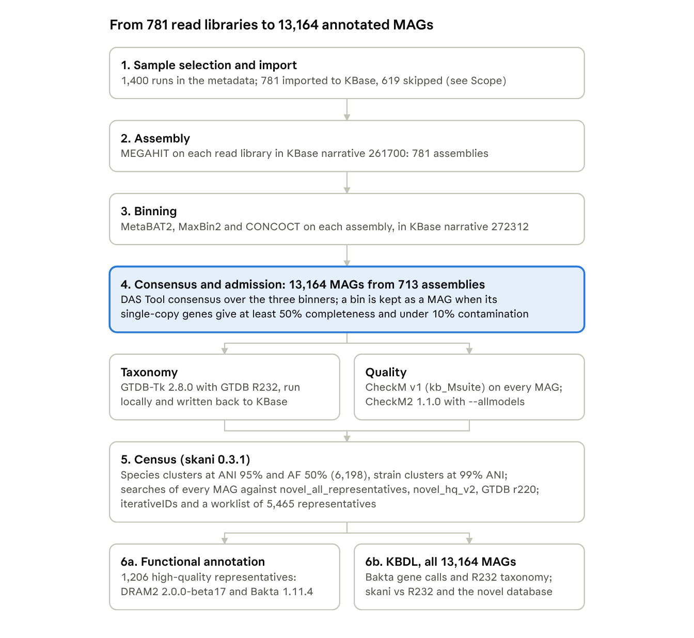
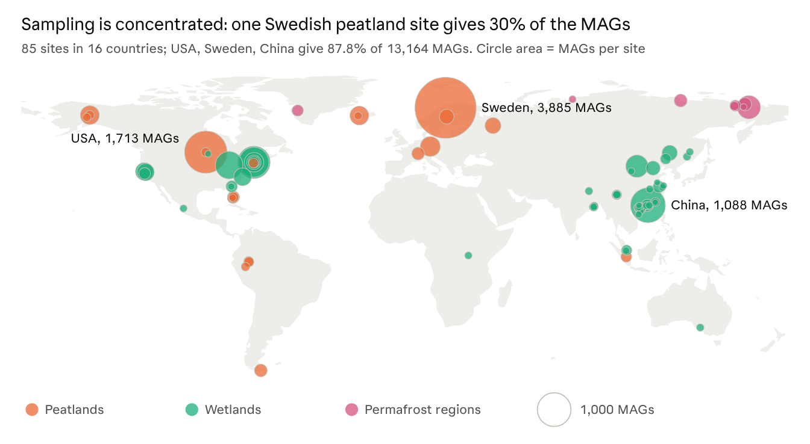
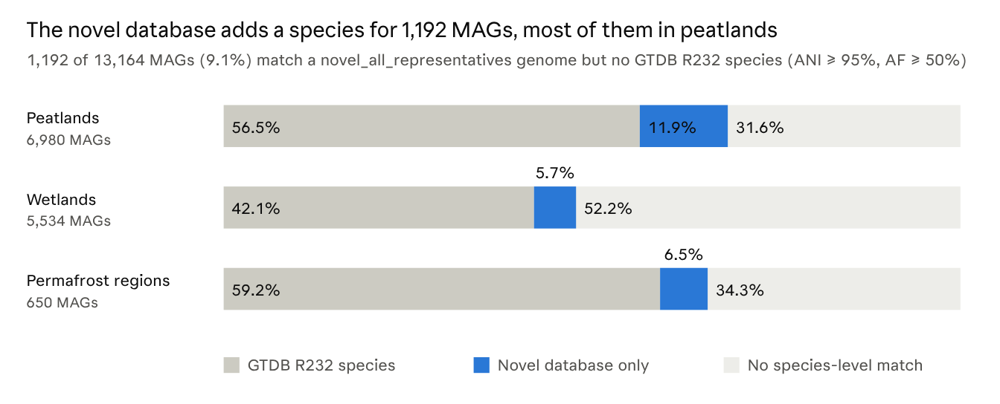

# Wetland MAG Scope Report

24 November 2026 · exported from the Claude Docs report https://claude.ai/artifact/Y56z6pBeSM1M8DWg9DqpSR

The census holds **13,164 MAGs** from 713 of the 781 imported peatland, wetland and permafrost metagenomes, collected at 85 sites in 16 countries. CheckM2 rates 4,304 of them high quality and 7,011 medium.

**6,658 MAGs (50.6%)** fall in a GTDB R232 species. Matching against the novel-genome database `novel_all_representatives` places **1,192 more (9.1%)** in species already recovered by other metagenome studies. That leaves **5,314 (40.4%)** with no species-level match anywhere.

## Scope

The census covers every MAG recovered from the 781 runs imported into KBase. The other 619 runs in the sample metadata were left out on purpose.

| Stage | Count | Notes |
| --- | --- | --- |
| Runs in the sample metadata | 1,400 | Peatlands 884, Wetlands 423, Permafrost regions 93; 17 countries |
| Imported into KBase (narrative 261700) | 781 | Paired-end read libraries |
| Assembled (MEGAHIT) | 781 | 770 in June; the 11 that had failed were re-assembled on 2026-11-15/16 |
| Assemblies that yielded MAGs | 713 | 68 assemblies gave no bin passing DAS Tool |
| MAGs (narrative 272312) | 13,164 | 12,859 from the first pass + 305 from the 11 re-assemblies (run 4) |
| BioProjects with MAGs | 379 |  |

**Runs left out (619):**

- **612 runs whose BioSample already has MAGs in SPIRE v1.** They were skipped at import so as not to re-derive MAGs SPIRE has already published. Their SPIRE MAGs are partly visible to the census through the novel-genome database (see below).
- **7 runs with no INSDC accession** (BioProject "This study"; Hainan, Guangdong and Liaoning sites), which cannot be fetched.

**Admission rule for a MAG:** a DAS Tool consensus bin with single-copy-gene completeness of at least 50% and contamination below 10%. A quality tier is then assigned by CheckM2, below.

## Processing pipeline

Every MAG went through the same pipeline: assembly and binning in KBase, then taxonomy, quality and a skani census, then two annotation routes.

*processing pipeline · 6 stages, 2 annotation routes*

- **Where each step runs:** steps 1–4 run as KBase apps. GTDB-Tk runs on the local workstation and CheckM2, the census searches, DRAM2 and Bakta run on poplar; results are written back to KBase or KBDL.
- **Two annotation routes:** DRAM2 and Bakta annotate the coding and non-coding genes of the 1,206 representatives. KBDL built 13,115 of the 13,164 MAGs with Bakta gene calls; 49 wait on a fix for a Bakta edge case. KBDL stores no CDS functions yet.
- **Run 4:** the 11 libraries whose first assembly failed were re-assembled and pushed through every step. That added 305 MAGs on 2026-11-24.

## Quality

CheckM2 puts **4,304 MAGs (32.7%) in the high tier** and 11,315 (86.0%) at medium or better. Median completeness is 87.2% and median contamination 2.4%.

| Estimator | High (>90% / <5%) | Medium (≥50% / <10%) | Low |
| --- | --- | --- | --- |
| CheckM2 1.1.0 (`--allmodels`, model CheckM2 chose) | 4,304 | 7,011 | 1,849 |
| CheckM v1 (KBase kb\_Msuite) | 3,920 | 7,003 | 2,241 |
| DAS Tool single-copy genes (the admission filter) | 4,329 | 8,835 | 0 |

- **Tiers** are completeness / contamination thresholds in the MIMAG style. rRNA and tRNA are not yet required: Bakta and DRAM2 have called them for all 1,206 representatives, and KBDL for 13,115 of the 13,164 MAGs.
- **CheckM2 is the census estimate.** It used its specific (neural network) model for 2,244 MAGs and the general model for 10,920.
- **CheckM v1 under-rates reduced genomes.** Of 489 CPR (Patescibacteriota) MAGs, 18.2% pass >70% / <10% under CheckM v1 against 78.5% under CheckM2. For 149 DPANN archaea the figures are 42.3% and 68.5%.
- **Typical MAG:** 2.9 Mb in 259 contigs (medians).
- **In KBase:** CheckM v1 is stored on every MAG object. CheckM2 is saved as the report `CheckM2_all_MAGs_report_20261124` (272312/20991/1).

## Geographic sampling

The MAGs come from 85 sites in 16 countries, but a few sites dominate. One Swedish peatland site supplies 3,885 MAGs (29.5%), and the USA, Sweden and China together supply 87.8%.

*Sample_metadata_wetland_only.csv coordinates + census/outputs/mag_census.tsv · 85 sites (coordinates within 2 km merged) · land: Natural Earth 1:110m*

- **By continent:** North America 5,565 MAGs, Europe 5,240, Asia 2,217, South America 131, Oceania 6 and Africa 5. The tropics and the southern hemisphere are barely represented.
- **By habitat:** 54 wetland, 23 peatland and 8 permafrost sites. Each site is drawn in the habitat of most of its runs; 2 sites mix habitats.
- **Sites** are the metadata's sampling coordinates, merged when within 2 km of each other.

## What the novel-genome database added

Matching against `novel_all_representatives` gave a species-level match to **1,192 MAGs that GTDB R232 does not place in a species**, raising the share of MAGs in a known species from 50.6% to 59.6%.

The database holds 78,132 genomes: 74,005 SPIRE and MGnify MAGs from other metagenome studies, and 4,127 AllTheBacteria / BV-BRC isolates.

- **The rule is the same as GTDB's:** skani ANI ≥ 95% with alignment fraction ≥ 50%, from a brute-force search of every MAG.
- **The matches are environmental MAGs, not isolates.** 1,183 of the 1,192 go to SPIRE MAGs and 9 to MGnify MAGs. The isolate database `novel_hq_v2` matched 4 MAGs and no de novo cluster.
- **Most of it recovers the runs we skipped.** 861 of the 1,183 SPIRE matches (72.8%) are SPIRE MAGs from the BioSamples of the 612 runs left out at import. The census therefore still sees those samples' organisms where it shares them.
- **At the cluster level,** 515 of the 4,290 de novo species clusters (12.0%) have a member, nearly always the centroid, in the database.
- **It also corroborates R232.** 1,645 MAGs match both: a GTDB R232 species and a novel-database genome.
- **Near misses:** another 1,517 de novo MAGs hit the database below the species rule: 183 at ≥ 95% ANI but alignment fraction < 50%, 544 at 90–95%, 676 at 85–90% and 114 below 85%.
- **R232 vs the handoff's r220:** r220 gives a species to only 3,168 MAGs against R232's 6,658 (3,543 R232-only, 53 r220-only).

*census/outputs/mag_census.tsv · 13,164 MAGs, census run 4 (2026-11-24)*

Wetlands gain least from the novel database: 316 of 5,534 MAGs (5.7%), against 834 of 6,980 peatland MAGs (11.9%). Wetland MAGs are also the least characterised overall, with 52.2% matching nothing at species level.

## Sources

Every number above comes from these files and objects, as of 24 November 2026 (census run 4).

- **Census tables** ([wetland/census](https://github.com/ModelSEED/MicrobiomeNotebooks/tree/clauded-insights-figure7/wetland/census), branch `clauded-insights-figure7`): `outputs/mag_census.tsv` (one row per MAG), `outputs/clusters.tsv`, `outputs/headline.json`, `outputs/run4_vs_run3.json`. They are built by `census.py` and `census_run4.py`.
- **Scope:** `census/DATA_SCOPE.md` and `wetland/db_membership/mag_database_membership.csv` (the SPIRE BioSample rule and the SPIRE MAG ids of the 612 skipped runs). Coordinates and habitats come from `wetland/Sample_metadata_wetland_only.csv`.
- **KBase:** narrative 261700 holds the reads and assemblies; narrative 272312 holds the binning and the 13,164 MAGs. Its reports are `GTDBTk_R232_local_report_20261121` (272312/20981/1), `CheckM_all_MAGs_report_20261123` (272312/20990/1) and `CheckM2_all_MAGs_report_20261124` (272312/20991/1).
- **Novel-database matches:** a brute-force skani 0.3.1 search of every MAG (`census/run_census_rescan.sh`, `census/run_census_compute_run4.sh`). The same search was repeated through KBDL (`wetland/kbdl_build/skani_sweep/`), and 19,126 of its 19,131 pairs are identical.
